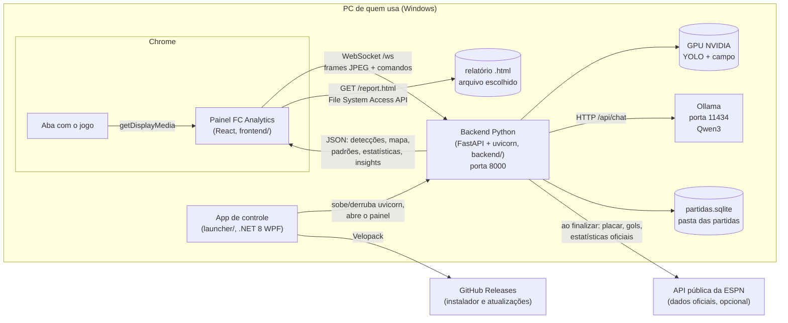
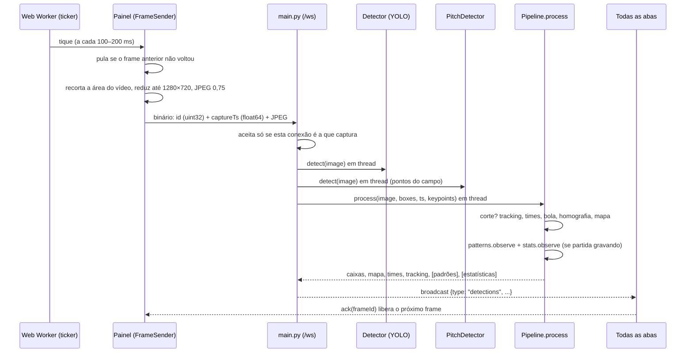

# 2. Arquitetura

## Componentes

- **Painel (frontend)**: página única servida pelo próprio backend em `http://localhost:8000/` (no app do Windows) ou pelo Vite em `http://localhost:5173` (desenvolvimento, com proxy). Captura a aba, manda frames, desenha tudo e manda comandos.
- **Backend**: um processo uvicorn com uma aplicação FastAPI (`backend/app/main.py`). Mantém o estado em memória (`app.state`): o detector, o detector do campo, o pipeline, as conexões abertas.
- **App de controle**: só cuida do ciclo de vida (instalar, iniciar, parar, abrir o painel, atualizar). Não participa da análise.
- **Ollama**: servidor local de LLM, instalado à parte pela pessoa. O backend fala com ele por HTTP (`OLLAMA_HOST`, padrão `http://127.0.0.1:11434`).

## Caminho de um frame

Detalhes importantes:

- **Um frame em voo por vez.** O `FrameSender` só manda o próximo quando recebe o resultado do anterior (ou depois de 3 s, quando o conta como perdido). Isso mantém o atraso estável em vez de deixar uma fila crescer.
- **O resultado vai para todas as abas abertas** (`broadcast`). Dá para capturar numa janela e ver o painel em outra. Cada aba sabe qual resultado é seu pelo campo `conn`.
- **Padrões e estatísticas só vão no frame quando mudaram** (`patterns_version != patterns_sent`, `stats_version != stats_sent`), para não mandar dezenas de KB a cada frame.
- **Sessão**: uma captura. `reset_session` (mandado pela página ao começar a capturar) ou um `captureTs` que volta no tempo (página recarregada) zera tracking, times, bola e homografia. Os padrões e a partida continuam.

## Threads e cadências

| O quê | Onde | Cadência | Thread |
| --- | --- | --- | --- |
| Detecção, campo, pipeline de um frame | `main.handle_frame` | cada frame (~3–7 fps) | `asyncio.to_thread` |
| Resumo dos padrões (formação, movimentação, leitura tática) | `Pipeline._maybe_summarize` → `PatternStore.summary` | a cada 10 s (relógio do servidor) | thread própria |
| Estatísticas da partida + alertas por regra | `Pipeline._maybe_stats` → `refresh_stats` → `InsightEngine.on_stats` | a cada 3 s | thread própria |
| Gravação no SQLite | `MatchStore.add_frame` / `flush` | lote a cada 1 s | a que chamou |
| Leitura do placar (OCR) | `TeamNameReader.maybe_read` | a cada 6 s até confirmar, depois a cada 60 s; só em tomada aberta | thread própria |
| Ollama: checagem e análise | `insights_pump` → `InsightEngine.tick` | tick a cada 5 s; checagem a cada 20 s; análise a cada 180/240/300 s | thread própria por análise |
| Envio do feed de insights | `insights_pump` | a cada 1 s, se mudou | loop asyncio |
| Refazer padrões do SQLite | `Pipeline.rebuild_patterns` | uma vez, ao criar o pipeline | thread própria |

Regras de concorrência:

- `Pipeline.process` segura `Pipeline._lock` durante o frame inteiro.
- `PatternStore`, `StatsTracker`, `MatchStore`, `InsightEngine` têm o próprio `threading.Lock`. Os resumos copiam os dados sob a trava e calculam fora dela.
- Os envios por WebSocket usam uma trava por conexão (`send` em `main.py`), porque tarefas diferentes podem mandar mensagens para a mesma aba.

## Estado global no backend (`app.state`)

| Campo | Conteúdo |
| --- | --- |
| `detector` | `Detector` (YOLO de jogadores/bola) |
| `pitch` | `PitchDetector` (pontos do campo) ou `None` |
| `pipeline` | `Pipeline` ou `None` (sem as bibliotecas de tracking, o backend só detecta) |
| `model_ready` | `asyncio.Event` liberado quando o modelo padrão carregou |
| `next_conn` | contador de conexões; cada aba recebe um `conn` |
| `clients` | conjunto das conexões abertas (para `broadcast`) |
| `capturer` | `conn` da única aba que pode mandar frames |
| `recent_frames` | últimos 20 frames (usados pela medição de modelos) |
| `last_frame` | `(imagem, mensagem, horário)` do último frame, para `/debug` |
| `result_times` | horários dos últimos 60 resultados (fps no `/debug/state`) |
| `setup_warning` | aviso mostrado no painel quando faltam bibliotecas |

## Dois modos de execução

| | App do Windows | Desenvolvimento |
| --- | --- | --- |
| Quem sobe o backend | `launcher/Backend.cs` (uvicorn sem `--reload`) | `iniciar.bat` ou `uvicorn ... --reload` |
| Página | `frontend/dist` servida pelo backend (`FCA_WEB_DIR`) em `:8000` | Vite em `:5173`, proxy de `/ws`, `/health`, `/debug`, `/report.html` |
| Ambiente Python | `%LocalAppData%\FCAnalytics\runtime\venv` (uv) | `backend/.venv` |
| Partidas | pasta escolhida (`FCA_DATA_DIR`) | `backend/data/` |
| Modelos | `%LocalAppData%\FCAnalytics\runtime\models` (`FCA_MODELS_DIR`) | `backend/models/` |
