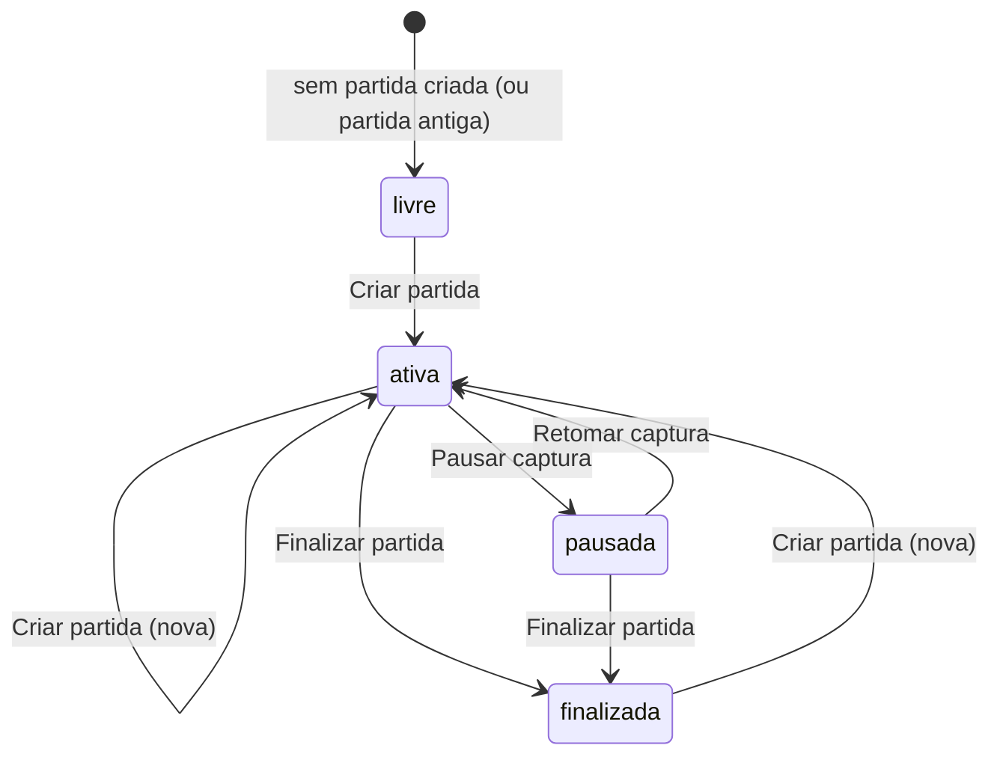

# 6. Dados e partida

## Onde cada coisa fica no disco

| O quê | App do Windows | Desenvolvimento |
| --- | --- | --- |
| Banco das partidas `partidas.sqlite` (+ `-wal`, `-shm`) | pasta escolhida pela pessoa (`FCA_DATA_DIR`), sugestão `E:\FC Analytics\partidas` | `backend/data/` |
| Configuração do LLM `llm.json` (`model`, `interval_s`) | mesma pasta das partidas | `backend/data/` |
| Modelos `.pt` (YOLO26, futebol, campo) e `modelo-escolhido.txt` | `%LocalAppData%\FCAnalytics\runtime\models` (`FCA_MODELS_DIR`) | `backend/models/` |
| Ambiente Python | `%LocalAppData%\FCAnalytics\runtime\venv` | `backend/.venv` |
| Configuração do app `settings.json` | `%LocalAppData%\FCAnalytics\runtime` | — |
| Registro do backend `backend.log` | `%LocalAppData%\FCAnalytics\runtime\logs` | janela do terminal |
| Relatório da partida `.html` | arquivo escolhido pela pessoa (ou Downloads) | idem |
| Modelos do Ollama | onde o Ollama guarda (`OLLAMA_MODELS`; no PC de referência, `E:\ollama\models`) | idem |

Nada disso vai para o git (`.gitignore`).

## Banco SQLite

`backend/app/stats.py`, classe `MatchStore`. Modo WAL, `synchronous=NORMAL`. Frames, posições e jogadas entram num buffer e são gravados em lote a cada 1 s (`flush`); eventos, insights e metadados são gravados na hora.

```sql
CREATE TABLE matches (id INTEGER PRIMARY KEY, started REAL NOT NULL, last REAL NOT NULL);
CREATE TABLE frames (match_id INTEGER NOT NULL,
  t, dt, poss, tilt, corridor, line0, line1, depth0, depth1, width0, width1,
  dist0, dist1, ball_x, ball_y, left0 REAL);
CREATE TABLE positions (match_id INTEGER NOT NULL, t REAL, pid INTEGER, team INTEGER, role TEXT,
  x REAL, y REAL, ghost INTEGER);
CREATE TABLE plays (match_id INTEGER NOT NULL, t REAL, team INTEGER, kind TEXT, pressers REAL, recovered INTEGER);
CREATE TABLE events (id INTEGER PRIMARY KEY, match_id INTEGER NOT NULL, t REAL, kind TEXT, team INTEGER);
CREATE TABLE insights (id INTEGER PRIMARY KEY, match_id INTEGER NOT NULL, wall REAL, t REAL, kind TEXT,
  team INTEGER, payload TEXT);
CREATE TABLE match_meta (match_id INTEGER NOT NULL, key TEXT NOT NULL, value TEXT, PRIMARY KEY (match_id, key));
-- índices por match_id em frames, insights, positions, plays, events
```

| Tabela | Uma linha por | Observações |
| --- | --- | --- |
| `matches` | partida | `started` e `last` em segundos Unix; `last` é o último frame gravado |
| `frames` | momento gravado | `t` = relógio da partida (sem pausas); `dt` = peso do momento (≤ 0,5 s); `poss`/`tilt`/`corridor` = time ou corredor (NULL se não há); `line*`/`depth*`/`width*` = forma de cada time (normalizada); `dist*` = metros andados no momento; `ball_x/y` = bola em metros (coordenadas do campo, não normalizadas); `left0` = 1 se o time 0 defende a esquerda |
| `positions` | jogador em cada momento | coordenadas do campo (não normalizadas), `role` = papel, `ghost` = 1 se fantasma |
| `plays` | passe ou perda | `kind` = `passe` ou `perda`; `pressers` = média de jogadores pressionando; `recovered` = 1 se recuperou em 5 s |
| `events` | evento manual | `kind` = `gol`, `amarelo`, `vermelho`, `substituicao`, `intervalo` |
| `insights` | item do feed | `payload` = o item inteiro em JSON |
| `match_meta` | chave da partida | `value` em JSON |

### Chaves de `match_meta`

| Chave | Valor | Quem grava |
| --- | --- | --- |
| `state` | `livre`, `ativa`, `pausada`, `finalizada` | `StatsTracker._save_lifecycle` |
| `name` | nome da partida ou `null` | idem |
| `pause_total` | segundos pausados até agora | idem |
| `pause_started` | horário Unix do começo da pausa atual ou `null` | idem |
| `pauses` | `[[tempo de jogo em que pausou, duração], ...]` | idem |
| `finished_at` | horário Unix do fim ou `null` | idem |
| `formations` | `{"0-ataque": "3-4-3", ...}` formações escolhidas à mão | `Pipeline.set_formation` |
| `team_names` | `{"names": [a, b], "anchors": [cor a, cor b], "source": "placar" | "manual"}` | `Pipeline._update_names` / `set_team_names` |
| `colors` | `[cor do time A, cor do time B]` da calibração | `Pipeline._match_colors` |
| `official` | resumo oficial da ESPN (`parse_summary`) + `order` (qual time oficial é o A e qual é o B) | `Pipeline.official_confirm` / `official_swap` / `official_clear` |

### Espaço em disco

O banco cresce com o tempo de jogo analisado, porque guarda a posição de cada jogador em cada momento. O painel mostra o tamanho (`storageBytes`) e o link **Apagar dados** (`wipe_data` → `MatchStore.wipe`: apaga todas as tabelas, `VACUUM` e `wal_checkpoint(TRUNCATE)`).

## Ciclo de vida da partida



| Estado | Grava? | Relógio | Painel |
| --- | --- | --- | --- |
| `livre` | sim (comportamento antigo, antes do botão Criar partida) | corre | mostra só **Criar partida** |
| `ativa` | sim (fora do intervalo marcado) | corre | **Escolher aba** / **Pausar captura**, **Finalizar partida** |
| `pausada` | não | parado | **Retomar captura**, **Finalizar partida** |
| `finalizada` | não | parado no fim | **Criar partida**, **Salvar relatório de novo** |

- `recording` = estado `ativa` ou `livre` **e** sem intervalo marcado. Com `recording` falso, `patterns.observe` e `stats.observe` não rodam e o LLM não analisa.
- **Retomada depois de reiniciar**: ao subir, o `StatsTracker` continua a última partida se ela teve dados há menos de 4 h (`STALE_MATCH_S`), recuperando estado, nome, pausas, eventos, frames e jogadas; o `InsightEngine` recarrega o feed; o `Pipeline.rebuild_patterns` refaz os padrões a partir de `positions` + `frames` (bola). Partida mais velha que 4 h: começa uma nova no estado `livre`.
- **Criar partida** (`create_match`): grava o que estava no buffer, cria a linha em `matches`, estado `ativa`, nome; zera padrões, formações manuais e nomes dos times; o feed de insights passa a ser o da partida nova (`bind_match`).
- **Relatório**: a página baixa `GET /report.html` e grava no arquivo escolhido a cada pausa e ao finalizar (veja [07-frontend.md](07-frontend.md#partida-e-relatório)).

## Formato do relatório

`backend/app/report.py`. Uma página HTML sem dependências externas (CSS embutido, SVG desenhado no servidor), em português, que abre offline e imprime em PDF. Seções: cabeçalho (nome, data, tempo analisado, placar com as cores, oficial ou "não conferido"), resumo final (`Story.summary()`), dados oficiais (gols, cartões e a tabela oficial × medido; sem eles, um aviso), eventos marcados no app e pausas, tabela de estatísticas da partida, posse minuto a minuto (barras empilhadas), uma seção por time (padrão atacando com as setas de passes e cruzamentos repetidos, padrão defendendo, movimentação de cada fase, posições, saída de bola, jogadas, defesa → ataque, mudanças), alertas e análises do LLM, os cards do Instagram (SVG inline, com botões que geram os PNG no navegador) e uma nota sobre a precisão. As fontes dos cards vão embutidas uma vez (cerca de 150 KB), então o relatório continua abrindo offline.
